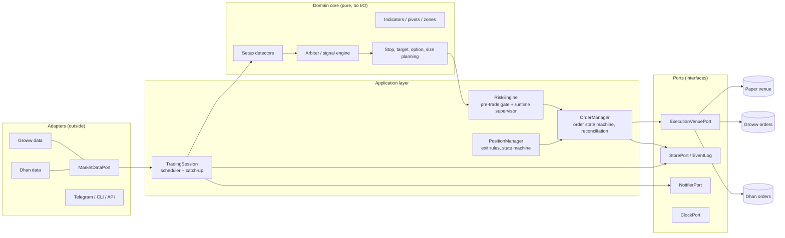

# Architecture: review of today and the target for a production bot

Status: review written after Phase 9. The code today is a good **paper-trading research
system**. It is not yet shaped for unattended live trading. This document lists what is sound,
what is not, and the target design. The work to get there is Phases 10 to 22 in `PROGRESS.md`.

## 1. What is sound today

| Property | Where | Why it matters |
|---|---|---|
| Strategy logic is pure and deterministic | `patterns/`, `indicators/`, `risk/`, `engine/` | Same code runs live, in replay and in tests; results are reproducible |
| Time is injected (`Clock`), IST everywhere | `core/clock.py` | Tests and replay are exact |
| Brokers are behind small protocols | `OptionDataSource`, `LiveDataSource`, `Notifier` | A second broker can be added without touching the strategy |
| Idempotency by design | deterministic `signal_id`, `Position.last_candle` | A restart or catch-up never double-trades |
| Safety by construction | `ReadOnlyGrowwClient` whitelist, startup guard, tests | No order path exists today |
| Typed config with validation | `config/settings.py` (pydantic), overrides validated | Bad values fail at start, not at 10:30 |
| Tooling | ruff, mypy `strict`, 350 tests, replay, sweep, reconcile | Fast feedback on changes |

## 2. Gaps against an industrial standard

Ordered by how much each would hurt a live system.

1. **No delivery process.** *(Closed in Phase 11.)* The project is committed, but had no
   branch policy, CI, lock file, enforced layer rules or tagged release to run a forward test
   against. Phase 11 added all of them (see `CONTRIBUTING.md`).
2. **Position lifecycle and fill simulation are one class.** `PaperEngine` decides *what* to do
   (stops, T1, T2) and also *pretends* the order filled. Live needs these separated: a
   position/exit manager that emits order **intents**, and an execution venue that turns an
   intent into real or simulated fills.
3. **No order model.** There is no order state machine (new, sent, acknowledged, partial,
   filled, rejected, cancelled), no client order IDs, no broker reconciliation, no handling of
   rejections or partial fills.
4. **Application logic lives in the wrong places.** `cli.py` (500 lines) holds replay
   orchestration and printing; `LiveRunner` (320 lines) mixes scheduling, polling, catch-up,
   alerts and heartbeat. Business flow should sit in application services, and the CLI should
   only parse arguments.
5. **Layer rules are conventions, not enforced.** *(Closed in Phase 11 with `import-linter`
   contracts in CI; the storage/paper cycle was removed in Phase 12 with a `PositionRepository`
   port.)*
6. **Persistence is thin.** SQLite with no schema version or migrations; positions are stored as
   one JSON blob (hard to query and to evolve); no append-only event log for audit and replay.
7. **Prices and money are plain floats.** Fine for research. Orders need tick-rounded price
   types, integer quantities and `Decimal` for rupees.
8. **Config mixes concerns and is not recorded with results.** Strategy rules, runtime timing and
   paper assumptions share one model; a trade does not record which config produced it.
9. **Logging is ad hoc.** `print` plus unstructured logs; no run ID, no metrics, no health
   endpoint.
10. **Broad `except Exception` in the runner** and no error taxonomy (retryable data error, fatal
    strategy error, broker rejection, risk breach each need a different reaction).
11. **Single-threaded polling.** Fine for paper. Live needs a streaming feed and order updates
    arriving while the strategy runs.
12. **Capability model is binary.** "Read-only client or nothing" cannot express live trading
    safely. It needs explicit capabilities, with live arming separate from configuration.
13. **Tests share helpers by importing other test modules** (`tests.unit.test_runtime`), and there
    are no contract, integration, property or failure-injection tests.
14. **Operations are undefined.** No service supervisor, deployment, backups, runbooks or
    dead-man alert.

## 3. Target architecture: ports and adapters (hexagonal)



Rules:

1. **Dependencies point inward.** Domain imports nothing from application or adapters.
   Application imports domain and ports. Adapters implement ports. Enforced in CI with
   `import-linter` contracts.
2. **One execution port, three venues.** `PaperVenue` (simulated fills, used for replay and the
   paper run), `ShadowVenue` (real quotes, simulated orders, compares to what would have filled),
   and broker venues (Groww, Dhan). The strategy cannot tell them apart. Choosing the live venue
   requires an explicit arming step (see 7).
3. **Intents, not orders, from the strategy.** The strategy and position manager produce
   `OrderIntent` (with an idempotency key derived from the signal id and leg). The order manager
   owns everything after that: sending, acknowledgements, partial fills, rejections, retries,
   cancellations and reconciliation with the broker's book.
4. **The broker is the source of truth for positions** once live. The local database is a
   cache plus the audit log. A reconciliation loop compares them and stops trading on a mismatch.
5. **Risk is a separate component with veto power**, outside the strategy. It gates every intent
   (size, exposure, daily loss, stale data, liquidity, price sanity) and can flatten everything
   (kill switch). It runs even when the strategy is stuck.
6. **Event-sourced audit trail.** Every decision is appended as an immutable event
   (`SignalGenerated`, `SignalRejected`, `IntentCreated`, `OrderSent`, `OrderAcked`,
   `OrderFilled`, `PositionClosed`, `RiskVeto`, `KillSwitchTripped`, config hash, code version).
   Tables for positions and P&L are projections of the events, so any day can be reconstructed.
7. **Capabilities, not a flag.** A broker client is built for a capability: `MarketData` only, or
   `MarketData + Trading`. Live trading needs the trading capability, a separate API key, a
   second explicit arming input, and a passing pre-flight (broker reconciliation, risk limits
   loaded, kill switch reachable). Paper and replay can never obtain the trading capability.

### Concurrency model

- One trading process, one writer to the order book.
- Streaming market data and order updates arrive on their own tasks and are put on one ordered
  queue. The strategy and the order manager consume that queue on a single logical thread, so
  state changes are never racing.
- Candles are built from ticks (with REST as the fallback and the cross-check), so the live
  candle equals the replay candle.
- Deterministic replay uses the same queue with recorded events.

### Data and persistence

- Repository interfaces over the store; SQLite stays for development, PostgreSQL for production.
- Versioned schema with migrations (Alembic). No JSON-blob positions: normalized orders, fills,
  positions, signals, events.
- Raw market data for each live day is archived (ticks or candles, option chain snapshots), so
  future validation uses real option data instead of synthetic premiums.
- Backups on a schedule, with a restore drill.

### Types and errors

- Value types for `Price` (tick-aware), `Qty` (lot-aware), `Money` (`Decimal`), `Points`.
- An error taxonomy: `DataError` (retry), `BrokerRejection` (handle per reason), `RiskBreach`
  (stop trading), `InvariantViolation` (stop and alert), `ConfigError` (refuse to start). The
  runner reacts per class instead of catching everything.

### Configuration

- Three separate documents: **strategy** (rules, versioned, hashed and recorded with every
  trade), **runtime** (timing, polling), **risk** (limits, with a separate approval step for
  loosening them). Secrets only from environment or a secret manager, never from files in the
  repository.

### Observability

- Structured JSON logs with a run ID, session date, signal id and order id on every line.
- Metrics: candle lag, data errors, order latency, rejects, slippage versus expectation, open
  risk, P&L.
- Health: heartbeat, a local health endpoint, a dead-man alert if the bot goes silent, and
  alerts to Telegram and a second channel.
- A daily report and a reconciliation report per session.

### Delivery and quality

- Git with protected main, pull requests, conventional commits, tagged releases.
- CI: ruff, mypy strict, tests, import-linter, dependency audit (`pip-audit`), a **golden replay**
  test (the 54-day replay must reproduce trade for trade), and coverage thresholds on domain
  and order code.
- Test pyramid: unit; contract tests for every adapter against recorded broker responses;
  integration with a fake broker that injects rejections, partial fills, disconnects and
  duplicates; property tests for the detectors and order state machine; end-to-end session test
  on a simulated clock.
- Pinned dependencies (lock file), reproducible builds, a container image.

### Deployment

- Always-on host (VPS or dedicated machine) with a static IP (brokers and regulators may require
  one for API orders), NTP time sync, firewall, non-admin service account.
- Service supervisor with automatic restart, scheduled start and stop, runbooks for restart,
  flatten, rollback and "broker down".
- Separate environments: dev (replay), staging (paper or shadow on real data), production.

## 4. Target package layout

```
src/orb_bot/
  domain/          pure strategy: patterns, indicators, planning, arbiter, value types
  application/     session, position manager, order manager, risk engine, reports
  ports/           MarketDataPort, ExecutionVenuePort, StorePort, NotifierPort, ClockPort
  adapters/
    groww/ dhan/   market data and order adapters (capability-scoped clients)
    venues/        paper, shadow
    storage/       sqlite, postgres, event log, migrations
    notify/        telegram, email
  interfaces/      cli, health endpoint (thin: parse and call application services)
  config/          strategy, runtime, risk schemas
tests/             unit, contract, integration, e2e, golden
```

The current code maps onto this with moves and splits, not a rewrite: `patterns`, `indicators`,
`risk` and `engine` become `domain`; `runtime` and the orchestration in `cli.py` become
`application`; `adapters/groww` stays and gains a capability split; `paper` splits into the
position manager (application) and `PaperVenue` (adapter).

## 5. How to get there safely

1. Tag the current version and keep forward-testing it. Do not change behaviour under the test.
2. Build the golden replay test first (current output saved as the reference).
3. Refactor in small, behaviour-preserving steps; the golden replay and the 350 tests must stay
   green after each one.
4. Add the order manager and the venues behind the existing paper path, so paper trading
   exercises the same code that live trading will.
5. Go live only through shadow mode, then 1 lot, with the risk engine and kill switch in place.
